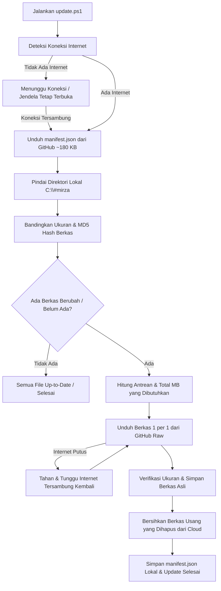

# Dokumentasi Lengkap AIO Mirza & Sistem Update GitHub

## ⚡ Perintah Langsung untuk Test / Eksekusi Update
Salin dan jalankan perintah PowerShell berikut (sebagai Administrator) untuk langsung menguji coba atau mengeksekusi skrip `update.ps1` dari GitHub:

```powershell
Start-Process powershell -ArgumentList "-NoProfile -ExecutionPolicy Bypass -Command `"iex (iwr 'https://raw.githubusercontent.com/mm1rza/aio-mirza/main/%23updateallfiles/update.ps1' -UseBasicParsing)`"" -Verb RunAs
```

---

Dokumentasi ini menjelaskan arsitektur repositori **AIO Mirza**, struktur folder, serta penjelasan teknis mendalam mengenai **sistem auto-update** berbasis PowerShell yang terhubung langsung ke GitHub.

---

## 📌 Sekilas Tentang AIO Mirza

**AIO Mirza** (*All-In-One Mirza*) adalah paket utilitas, aplikasi portabel, dan *system tweak* lengkap untuk kebutuhan teknisi komputer dan *maintenance* sistem operasi Windows. 

Paket ini dirancang agar dapat diinstal, diperbarui, dan dijalankan langsung dari direktori paten:
```text
C:\#mirza
```

Seluruh *shortcut* (`.lnk`) pada *root* direktori telah diarahkan secara spesifik ke *path* `C:\#mirza\...`, sehingga penempatan direktori ini sangat krusial agar semua utilitas portabel dapat langsung dieksekusi tanpa perlu konfigurasi ulang.

---

## ⚠️ PENTING: Dua Berkas Utama Proyek (Terkoneksi ke Windows Installer)

Proyek ini memiliki **2 berkas inti yang telah diintegrasikan langsung ke dalam custom Windows Installer (Setup / Unattended Windows)**:

| Path Berkas Wajib | Peran & Fungsi dalam Windows Installer |
| :--- | :--- |
| **`#updateallfiles\update.ps1`** | Skrip *deployment* dan sinkronisasi otomatis untuk menarik dan memperbarui seluruh ekosistem AIO Mirza langsung dari GitHub. |
| **`Regedit\allinout.reg`** | Berkas registri induk pasca-install (mengatur *AutoEndTasks*, restorasi Windows Photo Viewer klasik, optimasi *sharing printer* RPC, pembersihan folder 3D Objects & OneDrive, dan tweak sistem lainnya). |

> [!CAUTION]
> ### ATURAN NAMA & PATH BERKAS:
> - **NAMA DAN PATH DUA BERKAS DI ATAS TIDAK BOLEH DIRUBAH SAMA SEKALI!**  
>   Path `#updateallfiles\update.ps1` dan `Regedit\allinout.reg` sudah tertanam permanen di dalam sistem installer Windows. Jika nama file atau foldernya diubah, proses instalasi Windows otomatis akan putus (*error / missing file*).
> - **ISI/KONTEN BERKAS BEBAS DIUBAH:**  
>   Anda bebas memperbarui logika, menambah tweak registry baru, atau memodifikasi skrip di dalam kedua berkas tersebut kapan saja. Yang wajib dijaga adalah **nama berkas dan lokasi foldernya harus tetap sama**.

---

## 🚀 Cara Menjalankan & Menu Peluncur (Launcher)

Program diakses secara praktis melalui PowerShell dengan satu perintah:

```powershell
iex (iwr "https://mnet.my.id/update/github/aio" -UseBasicParsing)
```

Perintah di atas akan memanggil skrip peluncur (`mm1rza.ps1`) yang menyajikan 3 menu utama:

1. **Aktivasi Windows dan Office**  
   Mengeksekusi skrip aktivasi otomatis resmi Microsoft Activation Scripts (MAS) via `irm https://get.activated.win | iex`.
2. **Install Spotify Anti-Iklan**  
   Mengunduh dan memasang patch BlockTheSpot untuk Spotify versi desktop.
3. **Download dan Ekstrak File mm1rza ke `C:\#mirza`**  
   Menjalankan skrip updater (`update.ps1`) dengan hak akses Administrator (*Elevated RunAs*).

---

## 🔄 Penjelasan Rinci Sistem Update Modular (`#updateallfiles\update.ps1`)

Sistem update proyek ini telah ditingkatkan menjadi **Incremental Sync (Download 1 per 1)** tanpa menggunakan file ZIP besar. Repositori GitHub (`https://github.com/mm1rza/aio-mirza`) tetap menjadi *single source of truth* (pusat berkas resmi).

### Keunggulan Sistem Download 1 per 1 (Multithread Paralel):
1. **Sangat Cepat (8 Thread Paralel)**: Mengunduh hingga 8 berkas secara bersamaan (*concurrent worker threads*), mempercepat proses download hingga 5x - 8x lipat dibanding serial.
2. **Sangat Ringan & Efisien**: Tidak perlu mengunduh ulang arsip ZIP sebesar ~500 MB setiap ada update. Hanya file yang baru/berubah saja yang diunduh.
3. **Anti Timpa Ulang (*No Full-Overwrite*)**: File lokal yang sudah ada dan ukurannya/hash-nya cocok **langsung dilewati (SKIP)**.
4. **Kebal Koneksi Putus**: Jika internet mati di tengah proses unduh, skrip akan menunggu koneksi aktif kembali dan melanjutkan sisa file yang belum terunduh. Berkas yang sudah selesai diunduh tidak akan hilang atau diulang dari nol.

---

### Alur Kerja Teknis:



### 1. Deteksi Internet Otomatis & Anti Auto-Close (`Wait-ForInternet`)
* Skrip memverifikasi status koneksi sebelum mengakses GitHub.
* Jika internet tidak terdeteksi, jendela PowerShell **TIDAK akan keluar (*force close*)**, melainkan menampilkan status menunggu sembari melakukan pengecekan ulang berkala setiap 3 detik.
* Di akhir proses, selalu disediakan jeda `Read-Host "Tekan Enter..."` agar teknisi dapat melihat laporan hasil update dengan jelas.

### 2. Pengambilan Index Manifest Cloud (`manifest.json`)
* Skrip hanya mengunduh 1 file index ringan:
  ```powershell
  $manifestUrl = "https://raw.githubusercontent.com/mm1rza/aio-mirza/main/%23updateallfiles/manifest.json"
  ```
* File ini berisi daftar lengkap 1.300+ berkas proyek beserta path relatif, ukuran byte, dan kode *MD5 hash* masing-masing.

### 3. Analisis Cerdas & Perbandingan Berkas Lokal
* Skrip memeriksa setiap berkas di direktori `C:\#mirza`:
  * Jika berkas sudah ada, ukuran byte cocok, dan kode hash cocok: **Dilewati (*Skipped*)**.
  * Jika berkas belum ada atau kode hash berbeda: **Dimasukkan ke antrean unduh**.
* Jika seluruh berkas sudah cocok (misal 1322/1322 cocok), update selesai dalam hitungan detik tanpa memakan kuota sama sekali.

### 4. Pengunduhan Berkas Satu per Satu dari GitHub Raw
* Setiap berkas dalam antrean diunduh langsung dari URL raw:
  ```text
  https://raw.githubusercontent.com/mm1rza/aio-mirza/main/<encoded-path>
  ```
* Setiap file diunduh ke ekstensi sementara `.downloading`. Setelah ukuran dan integritasnya terverifikasi 100% valid, berkas dipindahkan ke lokasi permanennya.
* Jika koneksi internet drop saat mendownload file ke-5 dari 10:
  * File ke-1 s.d ke-4 **tetap aman dan tidak diulang**.
  * Skrip menunggu internet tersambung kembali, lalu melanjutkan file ke-5 dan seterusnya.

### 5. Sanitasi Berkas Usang (*Obsolete Cleanup*)
* Berkas lokal di `C:\#mirza` yang sudah tidak ada di repositori GitHub akan dibersihkan secara otomatis.
* Folder konfigurasi user seperti `APPPortable\cachewinbox\` **dikecualikan dari pembersihan** agar riwayat session user tetap aman.

---

## 📂 Mengapa Repositori Hanya Berisi Berkas-Berkas Wajib?

Repositori ini sengaja disusun **ramping dan terarah** (*lightweight & essentials-only*):

1. **Hanya Menyimpan Berkas Esensial & Portabel**:  
   Tidak menyimpan file *installer* berukuran raksasa atau *cache* sistem. Yang ada di dalam repositori hanyalah:
   * Aplikasi portabel ringan (tanpa perlu instalasi).
   * Konfigurasi Registry (`.reg`) untuk *tweak* instan.
   * Skrip otomasi PowerShell dan Batch.
   * *Shortcut* terarah (`.lnk`) untuk kemudahan akses pengguna.
2. **Koneksi Langsung ke Repositori GitHub**:  
   Semua klien teknisi akan selalu sinkron dengan versi di GitHub. Ketika pengembang menambahkan *patch regedit* baru, memperbarui versi *tool*, atau mengubah skrip, cukup lakukan *commit & push* ke GitHub serta menaikkan nomor versi di `version.txt`. Klien cukup menjalankan updater untuk menerima seluruh pembaruan secara otomatis.
3. **Efisiensi Bandwidth dan Waktu Unduh**:  
   Dengan hanya menyertakan berkas yang wajib dan esensial, proses *download*, ekstraksi, dan penyusunan folder di komputer teknisi berlangsung sangat cepat.

---

## 🗂️ Struktur Direktori dan Fungsinya

Berikut ringkasan isi folder di dalam repositori:

| Folder / Berkas | Fungsi dan Kegunaan |
| :--- | :--- |
| **`#updateallfiles/`** | Modul auto-update: berisi `update.ps1`, `manifest.json` (format terpadu: versi + index berkas & hash), `generate-manifest.ps1` (generator manifest otomatis), `version.txt` (cadangan kompatibilitas), serta skrip peluncur utama di subfolder `#master`. |
| **`@TEKNISI/`** | Berisi paket alat diagnosis teknisi: Antivirus, Hard Disk test, Partitioning, Data Recovery, System Info, dan Password reset. |
| **`APPPortable/`** | Kumpulan *software portable* siap pakai (CPU-Z, GPU-Z, HD Sentinel, HWiNFO, HWMonitor, PuTTY, TrafficMonitor, TreeSize, WinBox Mikrotik, FanControl, dll). |
| **`ChromeExtension/`** | Daftar domain pemblokir iklan (uBlock Origin) dan ekstensi pendukung peramban. |
| **`GpeditTask&Msconfig/`** | Jalan pintas (*shortcut*) cepat untuk membuka Group Policy Editor, MSConfig, dan Task Scheduler. |
| **`Host/`** | Berkas konfigurasi `hosts` untuk memblokir domain tertentu serta skrip pembantu. |
| **`Regedit/`** | Kumpulan berkas registri (`.reg`) siap pakai untuk optimasi Windows (matikan auto-update, hapus gallery Windows 11, matikan tombol F1, tweak performa, dll). |
| **`SharingPrinterWindows11/`** | Panduan visual (*tutor*) dan berkas registri untuk mengatasi masalah *sharing printer* di Windows 11. |
| **`Windows Tuneup/`** | Utilitas untuk mengatur Windows Defender, Windows Update, dan mengembalikan *Classic Right-Click Context Menu* di Windows 11. |
| **`*.lnk` (Root)** | Kumpulan jalan pintas langsung di *root* folder untuk membuka aplikasi portabel favorit tanpa perlu mencari ke subfolder. |

---

## 🛠️ Panduan Rilis untuk Pengelola (Maintainer)

Bagi pengelola yang ingin merilis pembaruan atau menambah berkas baru:

1. Buat, ubah, atau tambahkan berkas yang diinginkan di dalam repositori.
2. Jalankan skrip generator manifest di terminal PowerShell:
   ```powershell
   powershell -ExecutionPolicy Bypass -File ".\#updateallfiles\generate-manifest.ps1"
   ```
   *Skrip ini akan otomatis menghitung hash MD5 seluruh berkas, memperbarui `#updateallfiles\manifest.json`, dan mengisi `#updateallfiles\version.txt` dengan nomor build waktu terkini secara otomatis.*
3. Lakukan *commit* dan *push* perubahan ke branch `main` di GitHub:
   ```bash
   git add .
   git commit -m "Update berkas & rilis versi baru"
   git push origin main
   ```
4. Klien yang menjalankan menu updater akan otomatis mendownload `manifest.json` terbaru, mendeteksi hanya file yang baru/berubah, dan mengunduh file tersebut satu per satu tanpa mengulang dari awal.

