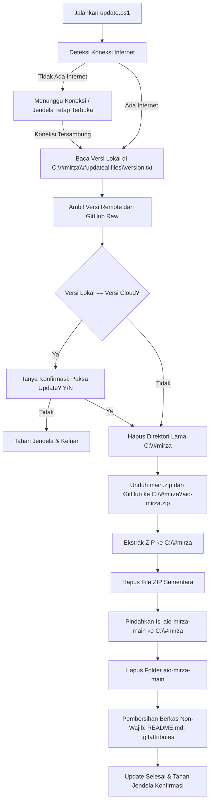

# Dokumentasi Lengkap AIO Mirza & Sistem Update GitHub

Dokumentasi ini menjelaskan arsitektur repositori **AIO Mirza**, struktur folder, serta penjelasan teknis mendalam mengenai **sistem auto-update** berbasis PowerShell yang terhubung langsung ke GitHub.

---

## 📌 Sekilas Tentang AIO Mirza

**AIO Mirza** (*All-In-One Mirza*) adalah paket utilitas, aplikasi portabel, dan *system tweak* lengkap untuk kebutuhan teknisi komputer dan *maintenance* sistem operasi Windows. 

Paket ini dirancang agar dapat diinstal, diperbarui, dan dijalankan langsung dari direktori paten:
```text
C:\#mirza
```

Seluruh *shortcut* (`.lnk`) pada *root* direktori telah diarahkan secara spesifik ke *path* `C:\#mirza\...`, sehingga penempatan direktori ini sangat krusial agar semua utilitas portabel dapat langsung dieksekusi tanpa perlu konfigurasi ulang.

---

## 🚀 Cara Menjalankan & Menu Peluncur (Launcher)

Program diakses secara praktis melalui PowerShell dengan satu perintah:

```powershell
iex (iwr "https://mnet.my.id/update/github/aio" -UseBasicParsing)
```

Perintah di atas akan memanggil skrip peluncur (`mm1rza.ps1`) yang menyajikan 3 menu utama:

1. **Aktivasi Windows dan Office**  
   Mengeksekusi skrip aktivasi otomatis resmi Microsoft Activation Scripts (MAS) via `irm https://get.activated.win | iex`.
2. **Install Spotify Anti-Iklan**  
   Mengunduh dan memasang patch BlockTheSpot untuk Spotify versi desktop.
3. **Download dan Ekstrak File mm1rza ke `C:\#mirza`**  
   Menjalankan skrip updater (`update.ps1`) dengan hak akses Administrator (*Elevated RunAs*).

---

## 🔄 Penjelasan Rinci Sistem Update (`#updateallfiles\update.ps1`)

Sistem update proyek ini memanfaatkan repositori GitHub (`https://github.com/mm1rza/aio-mirza`) sebagai *single source of truth* (pusat sumber berkas resmi).

Berikut adalah alur kerja teknis langkah demi langkah dari `update.ps1`:



### 1. Deteksi Internet Otomatis & Anti Auto-Close (`Wait-ForInternet`)
* Skrip dilengkapi fungsi `Test-Internet` dan `Wait-ForInternet` untuk memastikan ada akses ke GitHub sebelum melakukan *request*.
* **Jika komputer belum tersambung ke internet (LAN/Wi-Fi lepas):**
  * Jendela terminal **TIDAK akan langsung menutup (*force close*)** atau error *crash*.
  * Skrip menampilkan peringatan ramah dan melakukan *looping check* setiap 3 detik sembari menunggu pengguna mencolokkan kabel LAN atau mengaktifkan Wi-Fi.
  * Begitu internet terhubung, proses update otomatis langsung berlanjut.
  * Terdapat jeda `Read-Host "Tekan Enter..."` di setiap titik keluar (selesai / pembatalan) agar teknisi sempat membaca status layar tanpa jendela tiba-tiba hilang.

### 2. Pengecekan Versi (Version Control)
* Skrip membaca berkas versi lokal di:
  ```powershell
  $localVersionFile = "C:\#mirza\#updateallfiles\version.txt"
  ```
* Skrip mengunduh informasi versi terbaru dari GitHub secara langsung (*raw content*):
  ```powershell
  $remoteVersionUrl = "https://raw.githubusercontent.com/mm1rza/aio-mirza/main/%23updateallfiles/version.txt"
  ```
* Skrip membandingkan `$localVersion` dengan `$remoteVersion`:
  * **Jika versi sama**: Komputer sudah memiliki berkas terbaru. Pengguna diberi opsi konfirmasi apakah ingin melakukan *force update* (`Y/N`).
  * **Jika versi berbeda atau berkas lokal belum ada**: Proses pembaruan berkas otomatis dilanjutkan.

### 3. Reset dan Pembersihan Folder Lama
Untuk mencegah terjadinya konflik berkas lama, file korup, atau *leftover files* yang sudah dihapus di repositori terbaru, skrip menghapus direktori lama secara tuntas:
```powershell
if (Test-Path $folder) {
    Remove-Item $folder -Recurse -Force
}
```

### 4. Pengunduhan Arsip Terbaru dari GitHub
Skrip membuat folder baru `C:\#mirza` dan mengunduh seluruh *branch* utama dalam format ZIP:
```powershell
$downloadUrl = "https://github.com/mm1rza/aio-mirza/archive/refs/heads/main.zip"
$zipFilePath = "C:\#mirza\aio-mirza.zip"
$wc.DownloadFile($downloadUrl, $zipFilePath)
```

### 5. Ekstraksi dan Restrukturisasi Berkas
* Berkas `.zip` diekstrak menggunakan cmdlet `Expand-Archive`.
* Karena GitHub secara otomatis membungkus hasil ekstraksi ZIP ke dalam subfolder bernama `<nama-repo>-<branch>` (yaitu `aio-mirza-main`), skrip melakukan iterasi untuk memindahkan seluruh isi folder tersebut naik 1 tingkat ke `C:\#mirza`.
* Folder sementara `aio-mirza-main` dan berkas `aio-mirza.zip` langsung dihapus untuk menghemat ruang penyimpanan.

### 6. Pembersihan Berkas Non-Esensial di Komputer Klien
Setelah pemindahan selesai, skrip melakukan sanitasi akhir dengan menghapus berkas dokumentasi repo yang tidak diperlukan oleh pengguna teknisi di lingkungan lokal:
* `C:\#mirza\README.md`
* `C:\#mirza\.gitattributes`

Hasil akhirnya adalah folder `C:\#mirza` yang bersih, mutakhir, dan siap pakai.

---

## 📂 Mengapa Repositori Hanya Berisi Berkas-Berkas Wajib?

Repositori ini sengaja disusun **ramping dan terarah** (*lightweight & essentials-only*):

1. **Hanya Menyimpan Berkas Esensial & Portabel**:  
   Tidak menyimpan file *installer* berukuran raksasa atau *cache* sistem. Yang ada di dalam repositori hanyalah:
   * Aplikasi portabel ringan (tanpa perlu instalasi).
   * Konfigurasi Registry (`.reg`) untuk *tweak* instan.
   * Skrip otomasi PowerShell dan Batch.
   * *Shortcut* terarah (`.lnk`) untuk kemudahan akses pengguna.
2. **Koneksi Langsung ke Repositori GitHub**:  
   Semua klien teknisi akan selalu sinkron dengan versi di GitHub. Ketika pengembang menambahkan *patch regedit* baru, memperbarui versi *tool*, atau mengubah skrip, cukup lakukan *commit & push* ke GitHub serta menaikkan nomor versi di `version.txt`. Klien cukup menjalankan updater untuk menerima seluruh pembaruan secara otomatis.
3. **Efisiensi Bandwidth dan Waktu Unduh**:  
   Dengan hanya menyertakan berkas yang wajib dan esensial, proses *download*, ekstraksi, dan penyusunan folder di komputer teknisi berlangsung sangat cepat.

---

## 🗂️ Struktur Direktori dan Fungsinya

Berikut ringkasan isi folder di dalam repositori:

| Folder / Berkas | Fungsi dan Kegunaan |
| :--- | :--- |
| **`#updateallfiles/`** | Modul auto-update: berisi `update.ps1`, `version.txt`, serta skrip peluncur utama di subfolder `#master`. |
| **`@TEKNISI/`** | Berisi paket alat diagnosis teknisi: Antivirus, Hard Disk test, Partitioning, Data Recovery, System Info, dan Password reset. |
| **`APPPortable/`** | Kumpulan *software portable* siap pakai (CPU-Z, GPU-Z, HD Sentinel, HWiNFO, HWMonitor, PuTTY, TrafficMonitor, TreeSize, WinBox Mikrotik, FanControl, dll). |
| **`ChromeExtension/`** | Daftar domain pemblokir iklan (uBlock Origin) dan ekstensi pendukung peramban. |
| **`GpeditTask&Msconfig/`** | Jalan pintas (*shortcut*) cepat untuk membuka Group Policy Editor, MSConfig, dan Task Scheduler. |
| **`Host/`** | Berkas konfigurasi `hosts` untuk memblokir domain tertentu serta skrip pembantu. |
| **`Regedit/`** | Kumpulan berkas registri (`.reg`) siap pakai untuk optimasi Windows (matikan auto-update, hapus gallery Windows 11, matikan tombol F1, tweak performa, dll). |
| **`SharingPrinterWindows11/`** | Panduan visual (*tutor*) dan berkas registri untuk mengatasi masalah *sharing printer* di Windows 11. |
| **`Windows Tuneup/`** | Utilitas untuk mengatur Windows Defender, Windows Update, dan mengembalikan *Classic Right-Click Context Menu* di Windows 11. |
| **`*.lnk` (Root)** | Kumpulan jalan pintas langsung di *root* folder untuk membuka aplikasi portabel favorit tanpa perlu mencari ke subfolder. |

---

## 🛠️ Panduan Rilis untuk Pengelola (Maintainer)

Bagi pengelola yang ingin merilis pembaruan:

1. Buat atau perbarui berkas yang diinginkan di repositori lokal.
2. Buka berkas `#updateallfiles/version.txt` dan perbarui nomor build/tanggal (contoh: format `YYYYMMDD`).
3. Lakukan *commit* dan *push* perubahan ke branch `main` di GitHub:
   ```bash
   git add .
   git commit -m "Update tool & versi YYYYMMDD"
   git push origin main
   ```
4. Klien yang menjalankan menu updater akan otomatis mendeteksi perbedaan versi antara `version.txt` lokal dan *cloud*, lalu memperbarui sistem mereka ke versi terbaru.

